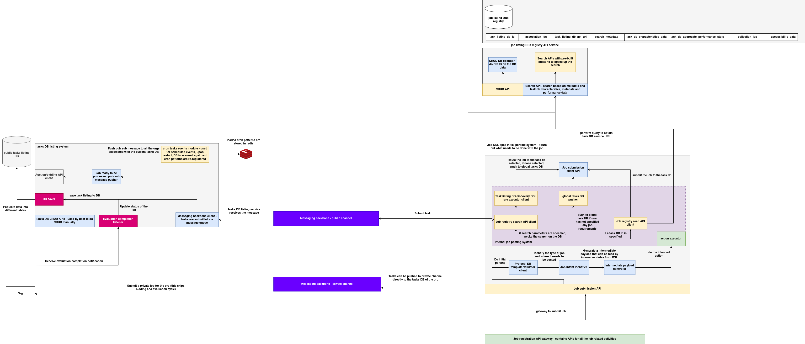

# Job submission system architecture

The **Job Submission and Task Listing System** is a distributed orchestration framework responsible for receiving, validating, routing, and storing jobs across public and private task databases. It supports both public (bidding + evaluation) and private (direct) job flows. Built with modular rule-based routing, DSL-driven validation, and pub/sub-based job distribution, the system facilitates both human and autonomous task scheduling.

It consists of the following primary subsystems:

---

### 1. Task DB Listing System

This subsystem is responsible for registering task listings into the public task DB and notifying relevant orgs of job availability.

#### **DB Saver**

Persists job metadata into the **public tasks listing DB**. Triggered by external org submissions or auto-routed job flows.

#### **Auction-Bidding API Client**

Initiates bidding or evaluation steps as per auction workflows. Connected to job submission for public tasks.

#### **Pub/Sub Message Pusher**

Pushes task listing updates to all orgs associated with the task via a public messaging backbone. This enables org-wide awareness.

#### **Cron Task Events Module**

Handles job scheduling patterns stored in Redis. Automatically reloads and re-registers cron patterns when the DB service restarts.

#### **Evaluation Completion Listener**

Monitors completion of evaluation cycles and updates the status of corresponding task records in the listing DB.

#### **Tasks DB CRUD APIs**

Manually accessible APIs that allow users to query, insert, update, or delete entries in the public task DB.

---

### 2. Messaging Backbone

This component handles asynchronous message distribution across orgs and task DBs. There are two separate channels:

#### **Messaging Backbone (Public Channel)**

Used for pushing public jobs after listing. Tasks go through the bidding/evaluation lifecycle and are received by downstream agents.

#### **Messaging Backbone (Private Channel)**

Bypasses listing and auction. Directly used when orgs submit **private jobs** to their internal task DBs without exposing them to the public channel.

---

### 3. Job Submission API Service

This subsystem is responsible for processing incoming job specs, resolving their destinations, validating their format, and submitting them to the appropriate task DB.

#### **Job Registry Search API Client**

Searches for the appropriate task DB using job metadata, constraints, or resource needs.

#### **Job Listing DB Discovery DSL Rule Executor**

Executes DSL rules to determine routing and matching logic for job-to-task DB assignment.

#### **Protocol DB Template Validator Client**

Validates incoming job specs against expected schema and protocol templates. Ensures compliance before routing.

#### **Job Intent Identifier**

Determines what kind of job is being submitted and where it needs to go (e.g., global pool or specific task DB).

#### **Intermediate Payload Generator**

Generates a structured payload that can be consumed by internal modules like the action executor.

#### **Action Executor**

Performs task-specific logic once the job is routed — such as submitting to a remote DB, executing a webhook, or transforming metadata.

#### **Job Submission Client API**

Responsible for pushing validated jobs to the selected **task DB** or to the global pool if routing requires it.

#### **Global Tasks DB Pusher**

Pushes jobs to the global task pool if no target DB is specified.

---

### 4. Job Listing DB Registry

This registry maintains references to all available task DBs in the system. It enables lookup, metadata search, and routing based on job requirements.

#### **CRUD API**

Allows creation and management of task DB registry entries.

#### **Job Registry Read API Client**

Used to read metadata about task DBs for routing purposes.

#### **Search API**

Supports filtering based on DB characteristics, tags, collections, and accessibility features.

---

### 5. Org Interaction Interface

This layer allows organizations to either:

* Submit public jobs (which go through the auction and evaluation lifecycle)
* Submit private jobs directly to their internal task DBs using the private channel

